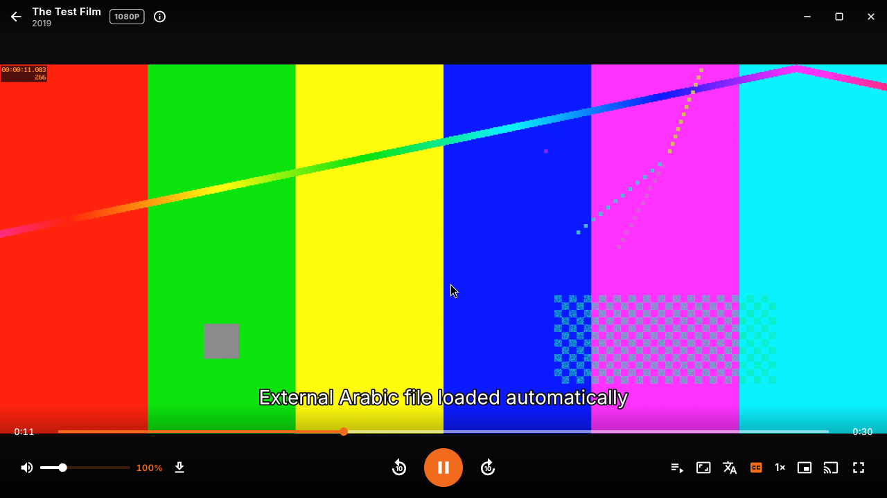
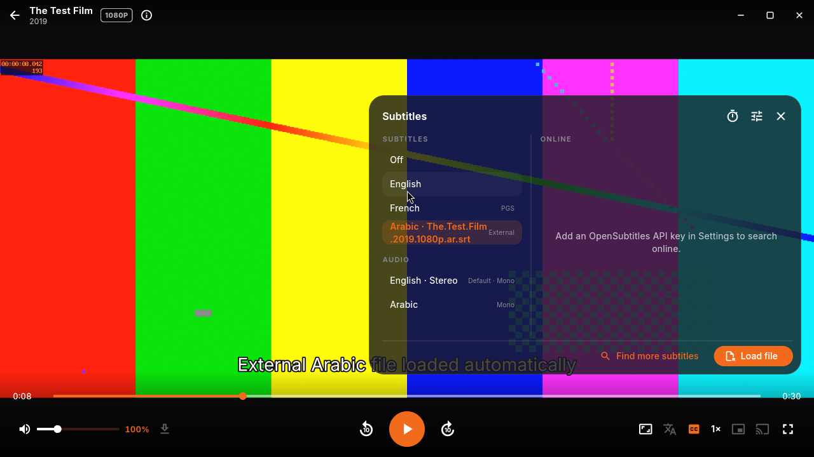
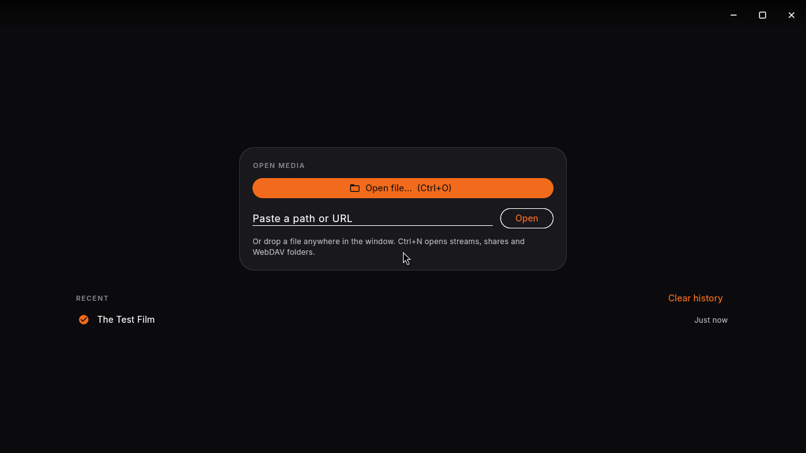
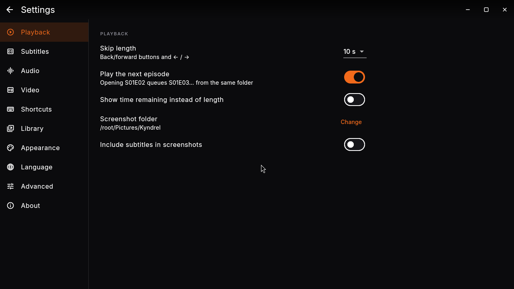
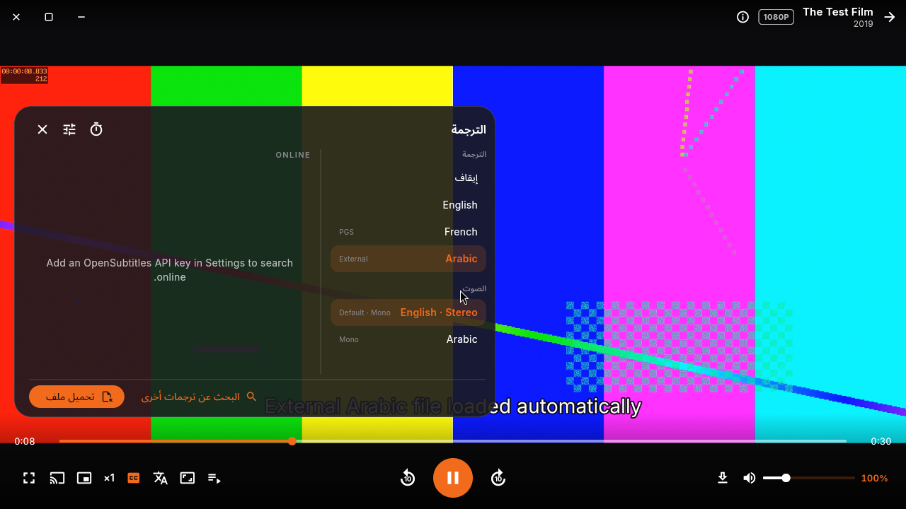

# Kyndrel

A video player for Windows, macOS, Linux and Android, built on **libmpv**
(via [media_kit](https://github.com/media-kit/media-kit)) with a dark,
orange-accented Flutter interface.



| | |
|---|---|
|  |  |
|  |  |

## Features

**Playback**
- Plays what mpv plays (MP4, MKV, AVI, WebM, HEVC, AV1, 10-bit, HDR10,
  HLS, DASH…) with hardware decoding (`hwdec=auto-safe`).
- Volume up to **400 %** with a limiter above 100 %. Speed 0.5–2× (any
  0.1–4×) with pitch correction.
- Sleep timer: a duration, end of episode or end of next episode, with
  fade-out.
- Chapters, A-B loop and frame stepping. Fit, fill, stretch, aspect
  overrides, zoom and rotate.
- Picture quality presets with an optional sharpen shader, a
  hardware-decoder choice and HDR tone mapping. Audio normalisation and a
  10-band equaliser.

**Subtitles**
- Embedded, image (PGS/VobSub) and external tracks. Files like
  `Film.en.srt` next to the video load automatically.
- Sync offset, dual subtitles, and styling with a live preview.
- OpenSubtitles search and download.
- Translation to another language through Claude, DeepL or Google.

**Library**
- Resume where you left off, history with thumbnails, and "continue
  watching".
- Queue with shuffle and repeat. Opening an episode queues the rest of
  its season.
- Folder playlists. Titles and posters from TMDB (optional API key).

**More**
- Network streams and WebDAV shares, with login headers.
- Downloads via yt-dlp.
- Casting to Chromecast and DLNA (beta).
- Picture-in-picture.
- Media keys and the OS media controls (MPRIS, SMTC, Now Playing).
- Lua/JavaScript mpv user scripts.

**App**
- Frameless window. Every shortcut can be rebound.
- English and Arabic (right-to-left).
- Keyboard and screen-reader accessible.
- Installers and an update check.
- A log viewer, plus an opt-in offer to report a crash on GitHub.

## Keyboard

Every shortcut can be changed in Settings › Shortcuts.

| Key | Action | Key | Action |
|---|---|---|---|
| Space | Play / pause | ← / → | Seek by the skip length |
| ↑ / ↓ | Volume | M | Mute |
| F, double-click | Full screen | Esc | Close panel / leave full screen |
| [ / ] | Slower / faster | S | Subtitles & audio |
| N / P | Next / previous in queue | Q | Queue |
| PgDn / PgUp | Next / previous chapter | L | A-B loop |
| . / , | Next / previous frame | I | Picture in picture |
| Ctrl+O | Open file | Ctrl+V | Open pasted path or URL |
| Ctrl+N | Open network stream | Ctrl+E | Effects |
| Ctrl+I | Media info | Ctrl+S | Screenshot |
| Ctrl+, | Settings | Tab | Move between controls |

Mouse: click to play/pause, scroll to change volume, right-click for a menu.
Touch: tap to show the controls, drag sideways to seek.

## Install

Download the installer for your system from
[Releases](https://github.com/xScropy/kyndrel/releases): the Windows setup,
the macOS DMG, the `.deb` (Debian 12+ / Ubuntu 23.04+), the AppImage, or
an Android APK (Android 7.0+). See [docs/packaging.md](docs/packaging.md)
and, for phones, [docs/android.md](docs/android.md): gestures for
brightness, volume and seeking with a scene preview, the media
notification, background audio and picture-in-picture.

## Build

Requires Flutter 3.50 (stable).

```sh
flutter pub get
flutter run -d windows            # or -d linux / -d macos / an Android device
flutter run -d linux -- <file>    # open a file on start
flutter run -d linux -- --diagnostics <file>   # decoder stats overlay
```

Linux needs libmpv, SQLite and the desktop toolchain:

```sh
sudo apt install libmpv-dev libsqlite3-dev clang cmake ninja-build pkg-config libgtk-3-dev
```

Android needs the Android SDK and JDK 21; `flutter build apk --release
--split-per-abi` makes one APK per processor type.

Optional API keys (Settings): OpenSubtitles for subtitle search, TMDB for
titles and posters, and Claude or DeepL for subtitle translation.

## Checks

```sh
flutter analyze
flutter test                                   # unit, widget and golden tests
scripts/make_test_media.sh                     # needs ffmpeg, python3-pil
flutter test -t engine --run-skipped test/engine   # against the real libmpv
```

CI runs all of these, builds Windows and macOS, and packages every
platform when `packaging/` changes. More docs:
[performance](docs/performance.md), [test matrix](docs/test-matrix.md),
[accessibility](docs/accessibility.md),
[localisation](docs/localisation.md),
[mpv properties used](docs/mpv-properties.md).

## Troubleshooting

- **Logs.** Settings › About › View log shows the app log, including mpv's
  warnings and errors. The files are `logs/kyndrel.log` (plus
  `kyndrel.1.log`) in the app's data folder:
  - `%APPDATA%\dev.kyndrel\kyndrel` on Windows
  - `~/Library/Containers/dev.kyndrel.kyndrel/Data/Library/Application Support/dev.kyndrel.kyndrel`
    on macOS (the app is sandboxed)
  - `~/.local/share/dev.kyndrel.kyndrel` on Linux
- **Crashes.** After a crash, Kyndrel offers to open a GitHub issue with
  the version, your OS and the end of the log filled in. Nothing is sent
  unless you submit it, and you can turn the offer off in Settings ›
  Advanced.
- **"Can't play this file".** The error screen shows mpv's reason and has
  a button to copy the log.

## Licence

Kyndrel is licensed under the **GNU GPL v3.0** (see [LICENSE](LICENSE)).
GPL-3.0 is compatible with both GPL and LGPL builds of libmpv/FFmpeg.
Bundled third-party components and their licences are listed in
[ATTRIBUTION.md](ATTRIBUTION.md).
